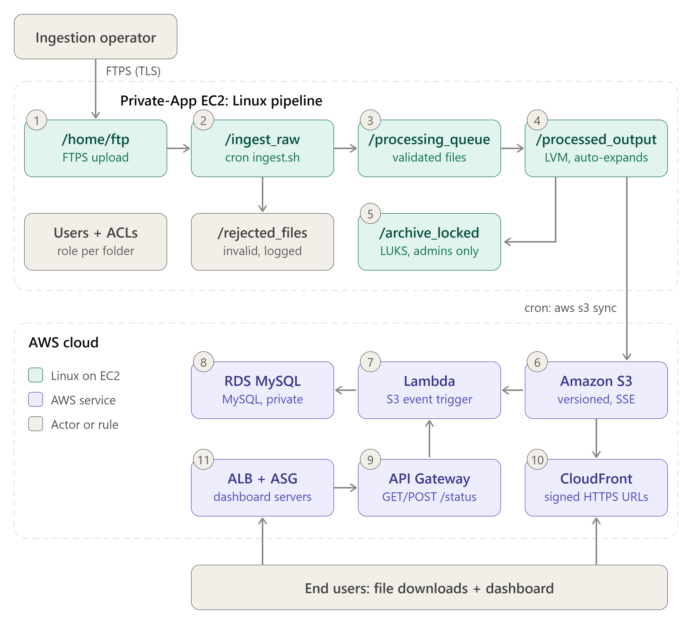
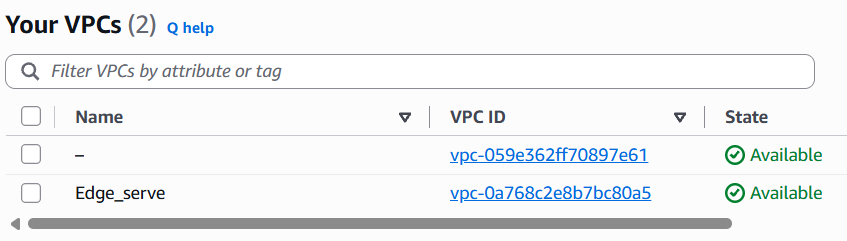
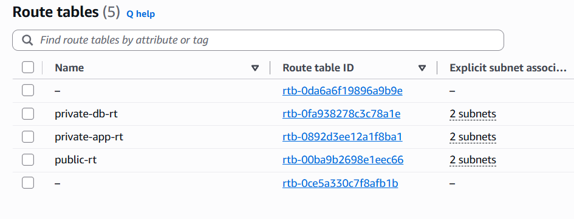
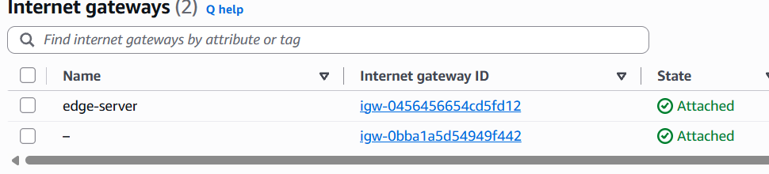
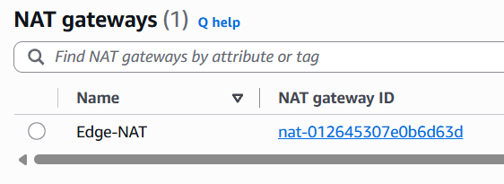
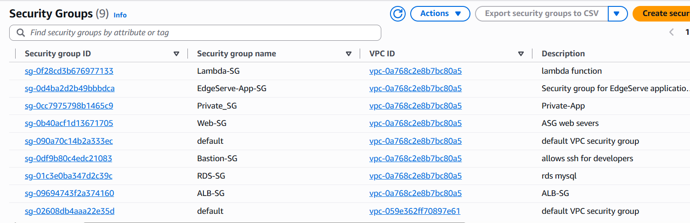
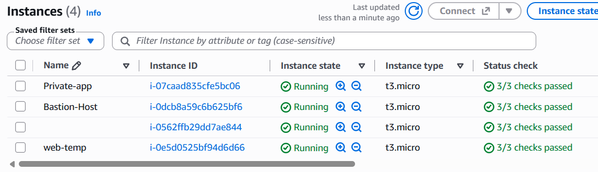

# EdgeServe: Secure Content Ingestion, Processing & Distribution Platform

A secure, automated content pipeline built with **Linux administration** and **AWS**. Authorized users upload files over FTPS. Scripts validate and process them, storage expands and encrypts itself, files sync to S3, and AWS services record, expose and deliver the content.


---

## Problem Statement

Organizations receive digital content from many contributors, but uploads are often unencrypted, manually checked, loosely access-controlled and hard to scale. This leads to data leaks, corrupt files and downtime. EdgeServe solves this with an automated, encrypted, role-based pipeline.

## Architecture




## Tech Stack

| Linux | AWS |
|---|---|
| Users and groups | VPC, subnets, IGW, NAT Gateway |
| ACLs | EC2 (Amazon Linux 2023) |
| vsftpd (FTPS) | IAM (users, groups, roles) |
| Cron + shell scripts | S3 |
| LVM | Lambda |
| LUKS | RDS MySQL |
| NFS | API Gateway |
| Apache httpd | CloudFront |
| | ALB + Auto Scaling Group |

## Workflow

| # | Stage | Location / Service | Mechanism |
|---|---|---|---|
| 1 | Upload | `/home/ftp` | FTPS (TLS, chroot) |
| 2 | Ingest | `/ingest_raw` | `ingest.sh` (cron, every minute) |
| 3 | Validate | `/processing_queue` or `/rejected_files` | `validate.sh`: accepts only valid `.tar.gz` |
| 4 | Process and store | `/processed_output` | `process.sh` (SHA-256 checksum), LVM volume |
| 5 | Archive | `/archive_locked` | `archive.sh`, LUKS-encrypted |
| 6 | Sync | S3 bucket | `aws s3 sync` (cron) with EC2 IAM role |
| 7 | Trigger | Lambda | S3 `ObjectCreated` event |
| 8 | Record | RDS MySQL | Lambda inserts file metadata |
| 9 | API | API Gateway | `GET` / `POST /status` |
| 10 | Distribute | CloudFront | HTTPS + signed URLs, S3 via OAC |
| 11 | Availability | ALB + ASG | Health checks, CPU-based scaling |

---

## Linux Implementation

### Users and Groups

| Group | Users | Role |
|---|---|---|
| `ingestors` | ingest1, ingest2 | Upload files |
| `processors` | proc1, proc2 | Process queued files |
| `itadmins` | admin1 | Full access, archive access |

Password aging enforced with `chage -M 30`.

### Directory Structure

| Directory | Purpose |
|---|---|
| `/home/ftp` | FTPS landing zone |
| `/ingest_raw` | Files awaiting validation |
| `/processing_queue` | Validated files |
| `/rejected_files` | Invalid files |
| `/processed_output` | Final output (LVM) |
| `/archive_locked` | Encrypted archive (LUKS) |
| `/system_logs` | Validation, processing, LVM and archive logs |

### ACL Matrix

| Directory | ingestors | processors | itadmins |
|---|---|---|---|
| `/home/ftp` | rwx | --- | rwx |
| `/processing_queue` | --- | rwx | rwx |
| `/processed_output` | --- | r-x | rwx |
| `/archive_locked` | --- | --- | rwx |

### FTPS (vsftpd)

```
anonymous_enable=NO
chroot_local_user=YES
userlist_enable=YES / userlist_deny=NO
ssl_enable=YES
force_local_logins_ssl=YES
force_local_data_ssl=YES
ssl_tlsv1_2=YES   (SSLv2, SSLv3, TLSv1 disabled)
pasv_min_port=40000
pasv_max_port=40100
local_root=/home/ftp
```

### Cron Automation

| Schedule | Script / Command | Task |
|---|---|---|
| Every minute | `ingest.sh` | Move completed uploads to `/ingest_raw` |
| Every 2 min | `validate.sh` | Accept valid `.tar.gz`, reject others, log result |
| Every 2 min | `process.sh` | Log SHA-256 checksum, move to `/processed_output` |
| Every 10 min | `lvm_autoexpand.sh` | Extend volume when usage is 80% or more |
| Every 5 min | `aws s3 sync` | Back up processed files to S3 |
| Weekly | `archive.sh` | Move old files into the LUKS archive |

### Storage

- **LVM:** `pvcreate` > `vgcreate edgeserve_vg` > `lvcreate processed_lv` > XFS > mounted at `/processed_output`. Extended online with `lvextend -r`.
- **LUKS:** `cryptsetup luksFormat` > `luksOpen archive_secure` > XFS > mounted at `/archive_locked`. Locked again after each archive run.
- **NFS:** `/processed_output` exported to the VPC CIDR (`rw,sync,no_subtree_check`) and mounted on a client instance.

---

## AWS Implementation

### Network (VPC `Edge_serve`, 10.0.0.0/16)

| Subnet | Type | Hosts |
|---|---|---|
| public-1a, public-1b | Public | Bastion, NAT Gateway, ALB |
| private-app-1a | Private | Private-App (ingestion server) |
| private-app-1b | Private | Web servers (ASG), Lambda |
| private-db-1a, private-db-1b | Private | RDS |

Internet Gateway for public subnets. NAT Gateway for outbound-only access from private subnets. S3 Gateway Endpoint on the private route table.

### Security Groups

| Group | Inbound |
|---|---|
| Bastion-SG | SSH from admin IP |
| ALB-SG | HTTP 80 from internet |
| Private_SG | SSH, FTP 21, 40000-40100, NFS 2049 from Bastion-SG |
| Web-SG | HTTP 80 from ALB-SG, SSH from Bastion-SG |
| Lambda-SG | None (outbound only) |
| RDS-SG | MySQL 3306 from Private_SG and Lambda-SG |

### Services

| Service | Configuration |
|---|---|
| **EC2** | Bastion-Host, Private-App (t3.micro, Amazon Linux 2023) |
| **IAM** | Groups: Ingestors, Processors, itadmins. `EdgeServe-EC2-Role` (S3 access), `EdgeServe-Lambda-Role` |
| **S3** | Versioning, SSE-S3 (AES-256), block public access, lifecycle rules (IA at 30 days, Glacier IR at 90 days) |
| **RDS MySQL** | Private subnet, no public access. Database `edgeserve_db`: `ingestion_jobs`, `processing_status`, `distribution_records` |
| **Lambda** | `edgeserve-record-handler` (Python, PyMySQL), inside VPC. S3 trigger (`.tar.gz`) and API Gateway handler |
| **API Gateway** | REST API `EdgeserveAPI`, resource `/status` with GET and POST, Lambda proxy integration, stage `prod` |
| **CloudFront** | S3 origin with OAC, HTTPS only, signed URLs via trusted key group |
| **ALB + ASG** | `Edgeserve-ALB` (internet-facing), target group health checks, `Edgeserve-ASG` with target tracking at 50% CPU |

---

## Screenshots

### Networking

| VPC | Route Tables |
|---|---|
|  |  |

| Internet Gateway | NAT Gateway |
|---|---|
|  |  |

**Security Groups**



### Compute and Linux

**EC2 Instances**



**FTPS (vsftpd) Configuration**


**NFS Export and Mount**


**Cron Jobs**


**LVM Creation and Expansion**


**LUKS Encryption**


**Validation Log (Accepted and Rejected)**


### AWS Services

**IAM Groups, Users and Role**


**S3 Bucket and Objects**


**RDS Database and Tables**


**Lambda Function and CloudWatch Log**


**API Gateway and API Response**


**CloudFront Distribution and Signed URL Test**


**Application Load Balancer**


**Auto Scaling Group**


### Output

**Web Dashboard**


---

## Results

- Secure FTPS ingestion with role-based access
- Automated validation: only valid `.tar.gz` accepted, rejects logged
- Self-expanding LVM storage and LUKS-encrypted archive
- Automated S3 sync with versioning, encryption and lifecycle rules
- Event-driven metadata recording in RDS MySQL
- REST status API and signed-URL content delivery
- Highly available dashboard through ALB and Auto Scaling

## License

Made by Noothan KT & Nandisa Das as Advanced Cloud & Future Trends course in 7th semester, RV University.
